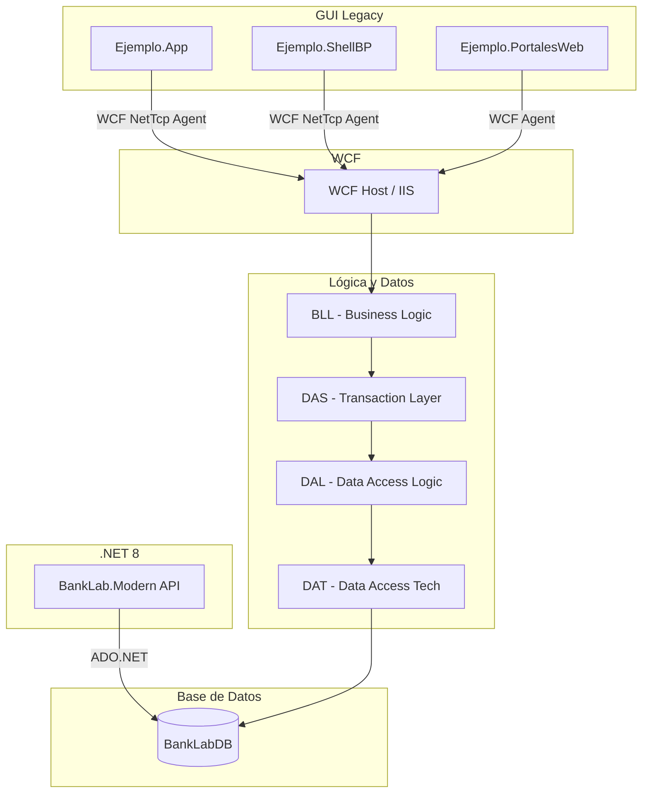

# Arquitectura General de BankLab

## Visión General
BankLab es un laboratorio bancario simulado para "Banco Ejemplo". La plataforma demuestra la coexistencia de aplicaciones legacy y modernas, estructurando el sistema en múltiples soluciones para representar un ecosistema empresarial realista.

## Soluciones
El sistema se compone de 10 soluciones:
- 9 Soluciones Legacy (.NET Framework 4.8)
- 1 Solución Moderna (.NET 8)

### Diagrama de Arquitectura

## Stack Tecnológico por Solución
- **Ejemplo.Comun**: .NET Fx 4.8 (DTOs, Utilidades, Extensiones)
- **Ejemplo.Componentes**: .NET Fx 4.8 (BLL, DAS, DAL, DAT)
- **Ejemplo.WCFServicios**: .NET Fx 4.8 (Contratos, Implementación WCF)
- **Ejemplo.App / ShellBP**: .NET Fx 4.8 (WinForms)
- **Ejemplo.PortalesWeb**: .NET Fx 4.8 (ASP.NET MVC 5)
- **BankLab.Modern**: .NET 8 (ASP.NET Core Web API)
- **Base de Datos**: SQL Server 2022+ (Procedimientos Almacenados)

## Flujo de Datos Legacy
El patrón de capas legacy sigue una estructura estricta:
GUI → WCF Agent → WCF Service → BLL (Business Logic) → DAS (Data Access Services / Transaction) → DAL (Data Access Logic) → DAT (Data Access Technology) → SQL Server (Stored Procedures)

## Flujo de Datos Moderno
El enfoque moderno simplifica las capas aprovechando inyección de dependencias:
HTTP Client → ASP.NET Core Controller → Application Service → Repository (ADO.NET puro) → SQL Server (Stored Procedures)

Ambas aproximaciones comparten la misma base de datos relacional `BankLabDB`.
