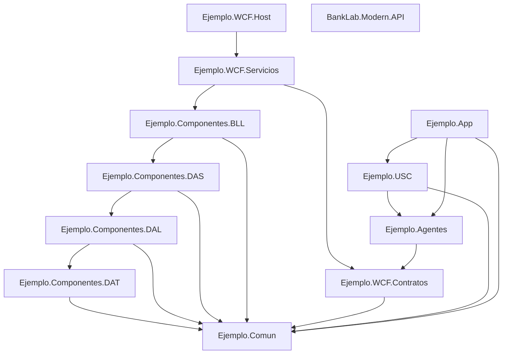

# Diagrama de Soluciones y Dependencias

## Diagrama de Dependencias

## Tabla de Proyectos

| Proyecto | Tipo | Framework | Dependencias Principales |
|----------|------|-----------|--------------------------|
| Ejemplo.Comun | Class Library | .NET 4.8 | (Ninguna) |
| Ejemplo.Componentes.DAT | Class Library | .NET 4.8 | Comun, System.Data |
| Ejemplo.Componentes.DAL | Class Library | .NET 4.8 | DAT, Comun |
| Ejemplo.Componentes.DAS | Class Library | .NET 4.8 | DAL, Comun |
| Ejemplo.Componentes.BLL | Class Library | .NET 4.8 | DAS, Comun |
| Ejemplo.WCF.Contratos | Class Library | .NET 4.8 | Comun, System.ServiceModel |
| Ejemplo.WCF.Servicios | Class Library | .NET 4.8 | Contratos, BLL |
| Ejemplo.WCF.Host | Console | .NET 4.8 | Servicios |
| Ejemplo.Agentes | Class Library | .NET 4.8 | Contratos, Comun |
| Ejemplo.USC | Windows Forms Control Library | .NET 4.8 | Agentes, Comun |
| Ejemplo.App | Windows Forms Application | .NET 4.8 | USC, Agentes, Comun |
| BankLab.Modern.API | ASP.NET Core Web API | .NET 8 | System.Data.SqlClient |

## Orden de Compilación
Para construir el sistema legacy completo sin errores, se debe seguir este orden:
1. Ejemplo.Comun (Base)
2. Ejemplo.Componentes (Capa de negocio y datos)
3. Ejemplo.WCFServicios (Contratos y servicios WCF)
4. Ejemplo.Agentes (Cliente WCF)
5. Ejemplo.USC (Controles de usuario WinForms)
6. Ejemplo.App / Web (Aplicaciones finales)

El API moderna (.NET 8) es independiente y puede compilarse por separado.
