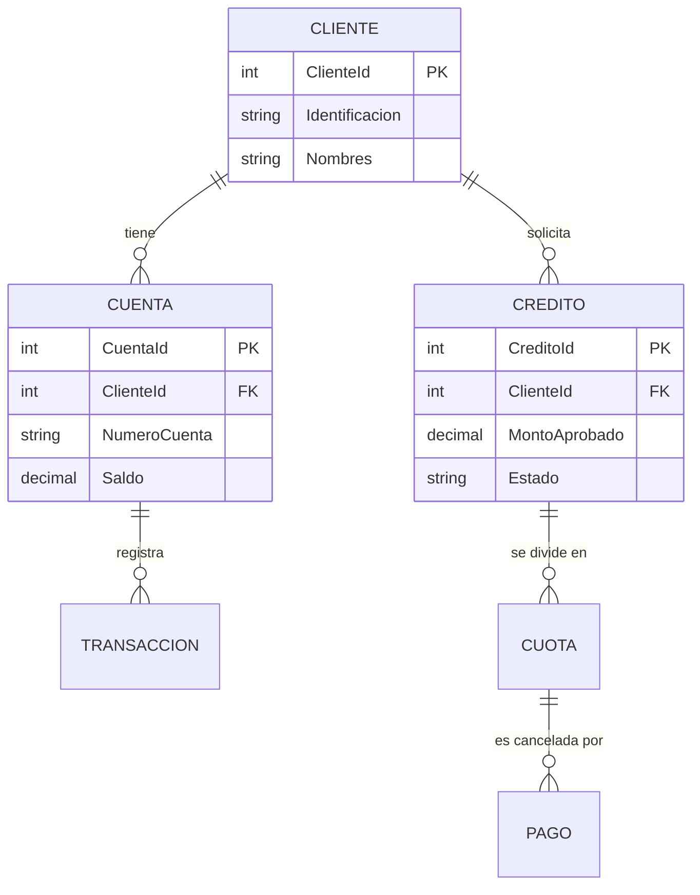
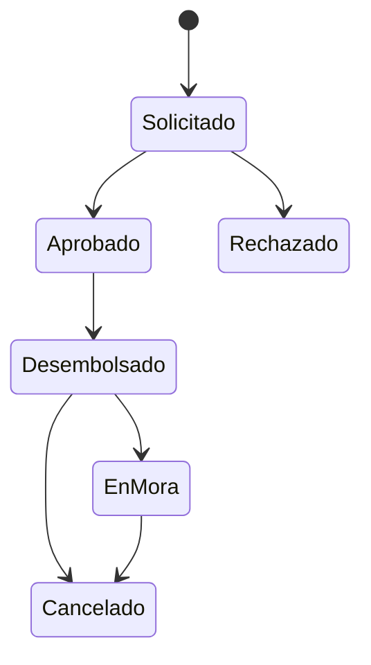

# Modelo de Datos

La base de datos `BankLabDB` consta de aproximadamente 40 tablas distribuidas en varios dominios funcionales.

## Diagrama Entidad-Relación (Simplificado)

## Dominios de Tablas

### Clientes
- `Clientes`: Información personal y demográfica.
- `Direcciones`: Múltiples direcciones por cliente.

### Cuentas y Ahorros
- `Cuentas`: Cuentas corrientes y de ahorro.
- `TransaccionesCuenta`: Movimientos (débitos/créditos) sobre las cuentas.

### Créditos y Cartera
- `Creditos`: Cabecera del préstamo.
- `Cuotas`: Tabla de amortización generada al desembolsar.
- `Pagos`: Registro de recaudación aplicada a cuotas.
- `Diferimientos`: Registro de arreglos de pago/refinanciamiento.

### Auditoría
- `LogTransacciones`: Traza de operaciones sensibles.
- `AuditoriaDatos`: Tabla genérica para cambios (Trigger-based).

## Patrón de Campos de Auditoría
Todas las tablas maestras y transaccionales implementan estos campos:
- `FechaCreacion` (DATETIME)
- `UsuarioCreacion` (VARCHAR)
- `FechaModificacion` (DATETIME, null)
- `UsuarioModificacion` (VARCHAR, null)
- `EstadoRegistro` (CHAR(1), 'A'=Activo, 'I'=Inactivo)

## Máquina de Estados: Crédito

