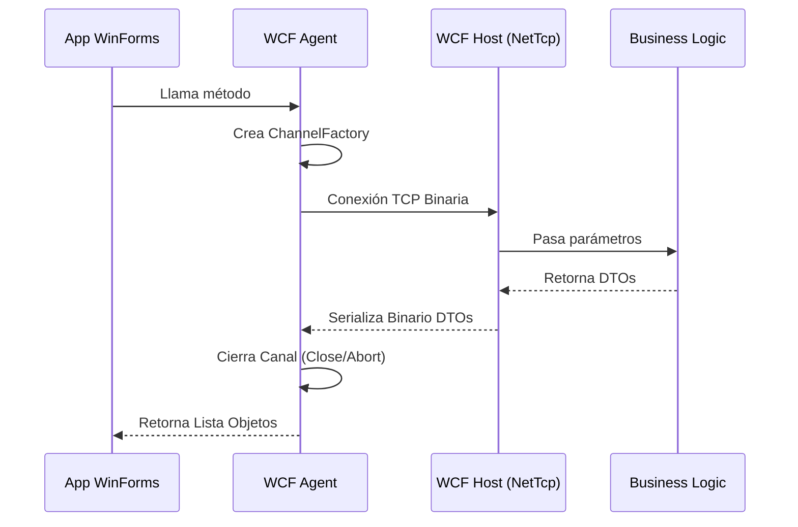

# Arquitectura WCF (NetTcp)

## ¿Qué es WCF?
Windows Communication Foundation (WCF) es un framework unificado para construir aplicaciones orientadas a servicios en .NET Framework. En BankLab, WCF es el puente entre las interfaces gráficas y la lógica de negocio.

## Por qué NetTcpBinding
BankLab está diseñado bajo el supuesto de que todos los clientes (aplicaciones de escritorio y portales web) operan en una red interna (Intranet).
- **Eficiencia:** Usa codificación binaria, mucho más rápida que el texto (XML/SOAP).
- **Protocolo:** Usa TCP directo, eludiendo la sobrecarga de HTTP.
- **Estado:** Soporta sesiones y conexiones persistentes eficientemente.

## Hospedaje (Hosting)
Actualmente el servicio está auto-hospedado en una aplicación de consola (`Ejemplo.WCF.Host`) por simplicidad para entornos de desarrollo.
- En un entorno de producción, los servicios deberían hospedarse en IIS (Internet Information Services) con WAS (Windows Process Activation Service) habilitado para permitir protocolos no-HTTP (net.tcp).

## Gestión de Canales (Agentes)
La instanciación y cierre de proxies WCF es propensa a errores (especialmente el caso de `Faulted state`). La capa de `Agentes` envuelve las llamadas usando `ChannelFactory<T>` y manejo seguro de estados de canal.

## Configuración (App.config)
```xml
<system.serviceModel>
  <services>
    <service name="Ejemplo.WCF.Servicios.ClientesService">
      <endpoint address="net.tcp://localhost:8808/ClientesService" 
                binding="netTcpBinding" 
                contract="Ejemplo.WCF.Contratos.IClientesService" />
    </service>
  </services>
</system.serviceModel>
```

## Diagrama de Secuencia WCF


